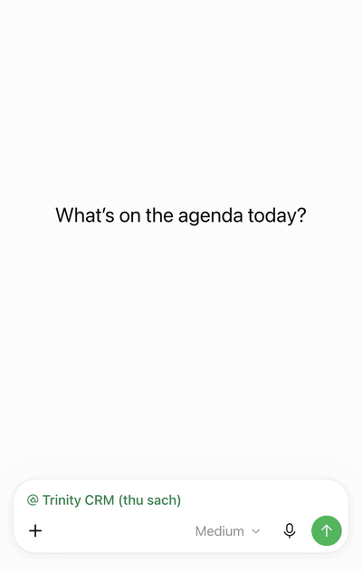
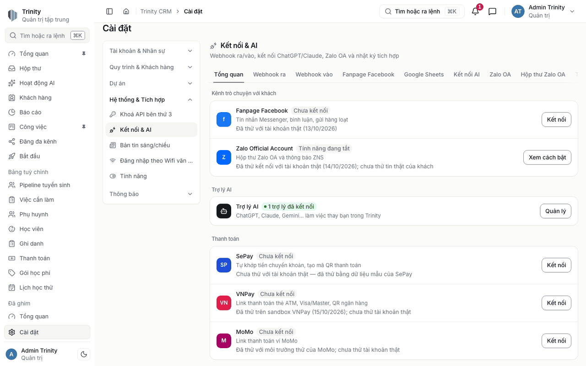
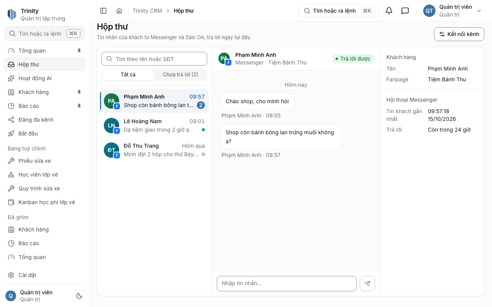
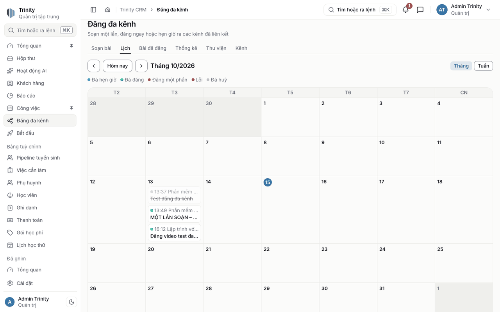
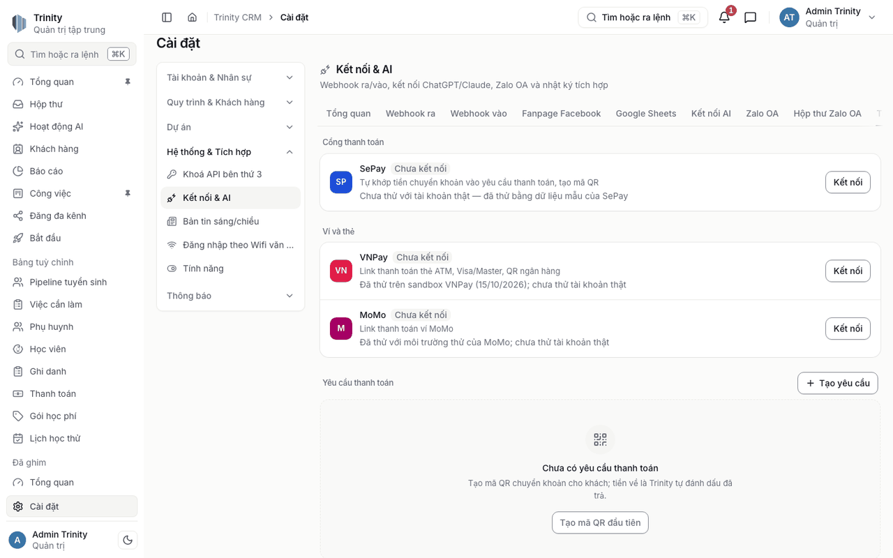

<div align="center">

# Trinity

**The open-source AI-native CRM.** Our vision: the AI operating system for business.
Run your whole company by chatting with the AI assistant you already love: ChatGPT, Claude, Gemini, and more.

Created by **Thanh Tran** · [X @trntnthnh](https://x.com/trntnthnh) · [YouTube](https://www.youtube.com/@ltvaicom) · [TikTok](https://www.tiktok.com/@laptrinhvoiai)

[Tiếng Việt](README.vi.md) · [Website](https://phanmemtrinity.com) · [Deploy](#deploy) · [Roadmap](ROADMAP.md) · [Contributing](CONTRIBUTING.md)


</div>

---

<p align="center"></p>

<p align="center"><sub>Real recording: ChatGPT with the Trinity plugin, on a fresh deploy made with the Vercel button below. The AI acts with your permissions, so the changes appear right away.</sub></p>

## Why Trinity

Most business software makes you learn its menus. Trinity flips that around: **you tell your AI assistant what you need, and it runs the system for you.**

- **"Add Mr. Nam from Gò Vấp, interested in product A, call him back Friday."** Done: contact, deal and reminder are created.
- **"How did the Q3 campaign do compared to Q2?"** Your assistant reads the data and answers with a chart.
- **"Every morning, sync new orders from my Google Sheet."** Trinity builds a small add-on for it. The add-on runs in its own sandbox, so it can never break the main system.

**Start lean, grow with you.** On first connect, your AI asks about your business, imports your Excel/Google Sheet, and builds the pipelines and screens you need. A core set (overview, customers, tasks, reports, inbox) is on; everything else is a switch in Settings › Features, and the menu only shows what is on. Your AI can turn features on for your industry.

**Built for Vietnamese businesses first.** Zalo, VietQR, Vietnamese UI and data formats work out of the box. Global CRMs don't cover these.

## How it works

Trinity ships a built-in **[Model Context Protocol (MCP)](https://modelcontextprotocol.io) server** with OAuth login. In the app, *Bắt đầu* ("Get started") asks which assistant you use (ChatGPT, Claude, Claude Code, Antigravity, Gemini CLI, Cursor, Codex CLI, VS Code Copilot…) and copies one prompt: paste it and the assistant adds the server, signs you in and starts setting up. Any MCP-capable assistant connects to it and gets tools for records, pipelines, reports and add-ons, scoped by the connecting user's role. The server itself never calls an AI model and holds no AI API keys: the intelligence comes from the assistant you bring.

```
Your AI assistant (ChatGPT · Claude · Gemini · Cursor · OpenClaw …)
        │  MCP + OAuth
        ▼
Trinity  ──  CRM · Sales · Zalo · HR · Reports
        │
        └── Add-ons (Deno sandbox, one process each)
```

## Features

| Area | What you get |
|---|---|
| **AI control (MCP)** | Built-in MCP server: connect ChatGPT, Claude, Gemini, Cursor, OpenClaw or any MCP client. Read and write data directly within the connected user's permissions (writes need the `crm.write` scope; every action is listed under AI activity). Optional setting *Require approval for AI changes* turns on a draft-then-approve flow |
| **Self-extending add-ons** | Ask your AI for a sync job, a custom workflow or a new integration. Each add-on runs isolated (separate process, sandboxed permissions, auto-disabled after repeated failures) |
| **AI-native overview** | The home page shows which AI assistants are connected and active, what they did today, and every connected channel (Fanpage, Zalo OA, YouTube, payments, online store) with its status and today's counts. With no assistant yet, it walks you through connecting one |
| **Feature switches** | Settings › Features: grouped cards (core, channels & inbox, sales, people, advanced), one switch each. Turning a feature off hides it for everyone and keeps the data. Your AI can list and switch features too (switching off needs your OK) |
| **Shared inbox** | Messenger and Zalo OA conversations in one place, with search and an "awaiting reply" filter; replies respect each platform's messaging window. Your AI assistant can read conversations and draft replies you approve |
| **Facebook Page automation** | Auto-replies to comments, hiding phone numbers, private replies; chat links and QR codes that open a conversation; Messenger flows; broadcasts within the 24-hour window. Rules, flows and broadcasts can also be created and edited from your AI assistant |
| **Multi-channel posting** | Write once, publish or schedule to Facebook Pages and YouTube, with a content calendar, a media library and post stats. Drafts, a weekly posting queue (time slots), reusable hashtag sets and signatures, UTM tagging of links, a per-channel preview of exactly what each network will show, bulk import from CSV, and recurring posts (daily, weekly or monthly). All of it can also be driven from your AI assistant |
| **Payments** | Payment requests with a VietQR code that SePay matches automatically when the money arrives; VNPay and MoMo payment links |
| **Sales connectors** | KiotViet, Sapo, WooCommerce, MISA, Shopee, Lazada: what each platform's API allows (customers, orders and/or products) is synced into the CRM; customers are matched to contacts by phone where the platform shares it (Shopee masks buyer phones). Per-connector scope in [status.md](docs/integrations/status.md) |
| **Online store** | A storefront at `/s/<name>` (or a subdomain) with three themes, a cart, cash on delivery or bank-transfer QR; orders and buyers land in the CRM. Off by default |
| **CRM** | Contacts with your own sources, stages and statuses, Kanban pipelines, shared record codes and `@` linking across screens, newsfeed |
| **Sales** | Products, POS |
| **People** | HR, attendance, payroll |
| **Insights** | Dashboards and reports |
| **Access control** | Roles and data scopes |

### How far it is tested

- **Tested end to end on a fresh deploy** (the Vercel button, a new Postgres database): first sign-in, connecting an AI assistant, building tables by chat, importing records, the AI tools.
- **Tested with real accounts**: publishing and scheduling posts to Facebook Pages and YouTube, Messenger messages.
- **Tested with sample data only**: the posting queue, recurring posts and CSV import, dashboards and reports, the AI-native overview, feature switches, POS, HR, attendance and payroll, the online store (sample shop).
- These areas have automated tests; connectors are listed below.

### Connectors and how far each is tested

| Connector | Tested |
|---|---|
| Facebook Page, YouTube | With real accounts |
| Zalo OA | Incoming messages tried with a real account; replies and sender profile need a paid Zalo OA (Tier) plan, not yet tried |
| VNPay | End to end on the VNPay sandbox |
| MoMo | MoMo test environment |
| WooCommerce | End to end with a test store |
| n8n | Sample workflows run against a test server |
| SePay, KiotViet, Sapo, MISA, Shopee, Lazada, Zapier, Make | Ready — not yet tried with a real account |
| Instagram, TikTok, Google Business Profile | Ready — not yet tried with a real account; the platform has to approve the app first |
| iPOS | Not built yet — waiting for iPOS's partner API |

Details per connector: [docs/integrations/status.md](docs/integrations/status.md). What comes next: [ROADMAP.md](ROADMAP.md).

## See it

<table>
<tr>
<td width="50%"><br><sub>Every channel and connector on one screen</sub></td>
<td width="50%"><br><sub>Shared inbox for Messenger and Zalo OA</sub></td>
</tr>
<tr>
<td><br><sub>Content calendar for multi-channel posting</sub></td>
<td><br><sub>Payments: SePay QR, VNPay, MoMo</sub></td>
</tr>
</table>

<p align="center"></p>
<p align="center"><sub>Online store with a sample shop (test products, CC0 photos).</sub></p>

## Tech stack

Next.js 16 · React 19 · Tailwind 4 · NestJS 10 · Express · Prisma 6 · PostgreSQL 16 · Redis · Deno (add-on sandbox) · pnpm monorepo.

## Deploy

Pick one path. Both give you the same app.

### Option 1: Vercel (serverless, no server to manage)

[](https://vercel.com/new/clone?repository-url=https%3A%2F%2Fgithub.com%2Ftanthanhkid%2Ftrinity&root-directory=apps/web&repository-name=trinity&env=JWT_SECRET,SERVICE_SECRET,CRON_SECRET,SEED_ADMIN_EMAIL,SEED_ADMIN_PASSWORD,INTEGRATIONS_MCP_ENABLED,INTEGRATIONS_SECRET_KEY&envDescription=Secrets%3A%20openssl%20rand%20-hex%2032.%20INTEGRATIONS_MCP_ENABLED%3Dtrue%20%28AI%20assistants%29.%20INTEGRATIONS_SECRET_KEY%3A%20openssl%20rand%20-base64%2032.%20Then%20the%20first%20admin%20account.%20See%20the%20README.&envLink=https%3A%2F%2Fgithub.com%2Ftanthanhkid%2Ftrinity%23deploy&products=%5B%7B%22type%22%3A%22integration%22%2C%22integrationSlug%22%3A%22neon%22%2C%22productSlug%22%3A%22neon%22%2C%22protocol%22%3A%22storage%22%7D%5D)

The button clones the repository into your GitHub account, creates the Vercel project with **Root Directory `apps/web`**, asks for the environment variables below and offers to add a **Neon Postgres** database. The repository is created under the name `trinity`; if you already have one with that name, change the name in the first step of the form.

Before you fill in the form:

1. **Click "Add Neon" first.** The environment-variable fields stay locked until the database is added.
2. **Turn Neon Auth off** when Neon offers it. Trinity has its own login and does not use it; leaving it on only adds unused `NEON_AUTH_*` variables.
3. **Pick a region close to your users** for both the Neon database and the Vercel functions (Project Settings → Functions → Function Region), for example Singapore (`sin1`) for Vietnam. The default is Washington (`iad1`), which makes the first request from Vietnam take about 5 s. Put the database and the functions in the same region.
4. Generate the secrets on your machine with `openssl rand -hex 32` (and `openssl rand -base64 32` for `INTEGRATIONS_SECRET_KEY`), and set `INTEGRATIONS_MCP_ENABLED` to `true`. Both are required: a new workspace is set up through your AI assistant, so without them it cannot get past the "Start" screen. If you forgot them, set them in Project Settings → Environment Variables and **redeploy**.

On every build, Vercel installs the workspace, builds it, applies the database migrations and seeds the first admin account (all idempotent, so redeploys are safe). Nothing else to run.

Environment variables (Project Settings → Environment Variables, or the form the button shows):

| Variable | Required | How to get it |
|---|---|---|
| `DATABASE_URL` | yes | Added for you by the Neon integration (Vercel → Storage → Neon). Any Postgres 14+ URL works. If your provider also gives a non-pooled URL, set it as `DATABASE_URL_UNPOOLED`: it is used for migrations |
| `JWT_SECRET` | yes | `openssl rand -hex 32` |
| `SERVICE_SECRET` | yes | `openssl rand -hex 32` |
| `CRON_SECRET` | yes | `openssl rand -hex 32` (protects the daily background-jobs endpoint that Vercel Cron calls) |
| `SEED_ADMIN_EMAIL` | recommended | Email of the first admin (default `admin@example.com`) |
| `SEED_ADMIN_PASSWORD` | recommended | Password of the first admin. If you leave it empty, a random one is generated and **printed once in the build log** (Deployments → the build → search for "Generated password"). There is never a fixed default password. Build logs are visible to everyone with access to the project, so **set `SEED_ADMIN_PASSWORD` yourself** and change it after the first login |
| `SEED_DEMO_DATA` | no | `true` adds a few sample contacts (default `false`; to get demo data set `SEED_DEMO_DATA=true`) |
| `INTEGRATIONS_MCP_ENABLED` | yes (the button asks for it) | `true` turns on the built-in MCP server (MCP URL: `https://<your-domain>/api/v1/mcp`) |
| `INTEGRATIONS_PUBLIC_BASE_URL` | for custom domains | On Vercel it falls back to the platform's production hostname (`VERCEL_PROJECT_PRODUCTION_URL`, never the request Host header), so set it only if you use your own domain; **everywhere else it is required** for MCP/OAuth, e.g. `https://crm.example.com` |
| `INTEGRATIONS_SECRET_KEY` | yes (the button asks for it) | `openssl rand -base64 32` (must be base64 of 32 bytes; it is a separate key and is not derived from `JWT_SECRET`). Keep it safe: losing it makes stored webhook secrets and OAuth tokens unreadable |

Deploying from the command line instead of the button (a fresh clone is enough). Run everything from the **repository root** (the project's Root Directory is `apps/web`, but the CLI has to upload the whole monorepo):

```bash
git clone https://github.com/tanthanhkid/trinity.git && cd trinity
vercel link --yes --project my-trinity                     # creates the project
vercel api -X PATCH /v9/projects/my-trinity -F rootDirectory=apps/web   # or: Settings > General > Root Directory
vercel api -X PATCH /v9/projects/my-trinity -F serverlessFunctionRegion=sin1   # functions near your users (default iad1 = Washington)
vercel integration add neon                                # or add any Postgres and set DATABASE_URL yourself
openssl rand -hex 32 | vercel env add JWT_SECRET production --sensitive
openssl rand -hex 32 | vercel env add SERVICE_SECRET production --sensitive
openssl rand -hex 32 | vercel env add CRON_SECRET production --sensitive
printf '%s' you@example.com | vercel env add SEED_ADMIN_EMAIL production
printf '%s' 'a-long-password' | vercel env add SEED_ADMIN_PASSWORD production --sensitive
printf true | vercel env add INTEGRATIONS_MCP_ENABLED production       # connect your AI assistant
openssl rand -base64 32 | tr -d '\n' | vercel env add INTEGRATIONS_SECRET_KEY production --sensitive
vercel deploy --prod
```

Tried on a fresh Vercel account (2026-10-15): about 4 minutes from clone to sign-in, most of it the first build.

- `vercel link` writes `.env.local` (a short-lived Vercel token) and adds it to `.gitignore`; `vercel integration add neon` also writes agent skill files (`.agents/`, `.claude/`, `skills-lock.json`). All are git-ignored and safe to delete.
- From the command line Neon is created in its default region and with Neon Auth on (unused `NEON_AUTH_*` variables, harmless). To choose the database region, add Neon from the Vercel dashboard (Storage) instead.
- The two `INTEGRATIONS_*` lines are required. A new workspace is set up through your AI assistant, so without them it stays on the "Start" screen. If you forgot them, add them and redeploy.

Then open the production URL and sign in with the admin account above. Notes:

- The first admin is only created when it does not exist yet; redeploying never overwrites a password.
- A new workspace starts empty on purpose: the sidebar only shows *AI activity* and *Settings* until your AI assistant builds the workspace from the *Bắt đầu* ("Get started") screen. After that the core set is on and everything else is a switch in Settings → *Tính năng* ("Features"); Zalo OA, for example, answers 403 until its switch is on. Settings is grouped in the Vietnamese UI as *Tính năng & Kết nối* (features & connections), *Khách hàng* (customer lists), *Công ty & Nhân sự* (users, roles, teams) and *Cá nhân* (profile, notifications); a section only shows when its feature is on.
- The interface is currently **Vietnamese only**. Your data and the AI tools work in any language.
- Vercel runs the API inside the Next.js app (one function, 60 s limit). Uploaded files need object storage: set `STORAGE_DRIVER=vercel-blob` with a Vercel Blob token, or an S3-compatible driver (see `.env.example`). Notifications use polling instead of WebSockets. Add-ons (Deno sandbox, the "Extensions" page) and Redis-backed features need a long-running server, so use Option 2 for them.

### Option 2: Self-host with Docker Compose

You need Docker with Compose. On a laptop the first build takes about 5 minutes.

```bash
git clone https://github.com/tanthanhkid/trinity.git
cd trinity
./install.sh --up
```

`install.sh` creates `.env` from `.env.example` with freshly generated random secrets and admin password (it never overwrites an existing `.env`, so it is safe to re-run), prints the admin credentials once, and starts the stack with `docker compose up --build -d`. Open http://localhost:3000 and sign in with the printed admin account. No demo data is seeded by default; if you want demo data, set `SEED_DEMO_DATA=true` in `.env` (or run `SEED_DEMO_DATA=true ./install.sh`) before the first start.

Manual alternative: `cp .env.example .env`, replace every `change-me-*` value (`openssl rand -hex 32`), then `docker compose up --build -d`. If `SEED_ADMIN_PASSWORD` is empty, the generated password is printed by `docker compose logs migrate`.

Tagged releases publish ready-made images to GitHub Container Registry (`ghcr.io/tanthanhkid/trinity-api`, `ghcr.io/tanthanhkid/trinity-web`). More in [docs/deployment.md](docs/deployment.md).

To let your AI assistant drive Trinity, set `INTEGRATIONS_MCP_ENABLED=true`, a public `INTEGRATIONS_PUBLIC_BASE_URL` and an `INTEGRATIONS_SECRET_KEY` in `.env`, then follow [docs/integrations](docs/integrations/).

For development without Docker: `pnpm install && pnpm dev` (needs Node 22, Postgres and Redis running locally).

### Monitoring (optional)

Error reporting (Sentry) and anonymous product metrics (PostHog) are **off by default**: no network call is made and
no SDK is loaded until you set the variables. Variables: `SENTRY_DSN` (API), `SENTRY_DSN_WEB` (browser),
`SENTRY_ENVIRONMENT`, `SENTRY_TRACES_SAMPLE_RATE`, `TRINITY_RELEASE`, `POSTHOG_KEY`, `POSTHOG_HOST`, `POSTHOG_REPLAY`,
`MONITORING_HASH_SECRET`. User ids are hashed (HMAC) before they leave your server; request bodies, cookies, headers,
query strings, emails and phone numbers are stripped; session replay (if enabled) masks all text and inputs. Server
events: `onboarding_step`, `feature_toggled`, `plan_changed`, `table_created`, `table_updated`, `post_published`,
`comment_rule_saved`, with keys, counts and booleans only. Details in [docs/deployment.md](docs/deployment.md#monitoring-optional).

## Why I built this

> *I'm Thanh. I build software with AI every day, and I kept seeing small businesses drown in menus and spreadsheets. So I built the system I wanted: one where you just tell your AI what to do. I'm giving it away so everyone can run their business this way.* — Thanh Tran

## Community

- 📺 YouTube: [Lập trình với AI](https://www.youtube.com/@ltvaicom) (Vietnamese tutorials, building with AI)
- 🎵 TikTok: [@laptrinhvoiai](https://www.tiktok.com/@laptrinhvoiai)
- 𝕏 X: [@trntnthnh](https://x.com/trntnthnh) (release news)
- 💬 Questions, ideas and show-and-tell: [GitHub Discussions](../../discussions)
- 🐛 Bugs: [GitHub Issues](../../issues)
- 🔒 Security issues: please follow [SECURITY.md](SECURITY.md), not public issues

## License

Trinity is licensed under **[AGPL-3.0](LICENSE)**. You can use, modify and self-host it for free. If you offer a modified version to others over a network, you must publish your changes under the same license.

Need to embed Trinity in a closed-source product or avoid AGPL obligations? A **commercial license** is available: see [COMMERCIAL.md](COMMERCIAL.md).

"Trinity" and the Trinity logo are trademarks. See [TRADEMARK.md](TRADEMARK.md).
