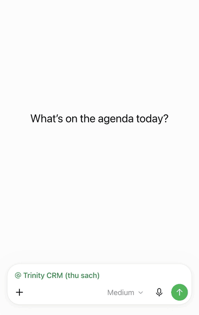
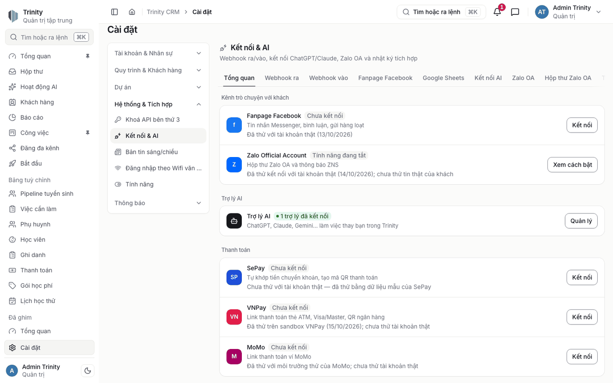
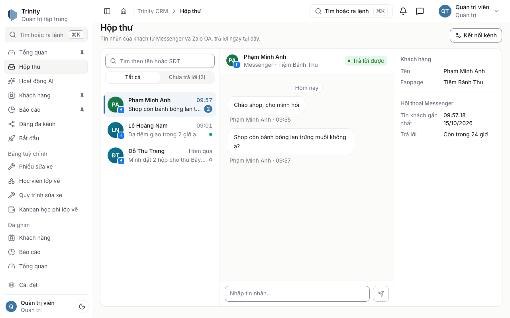
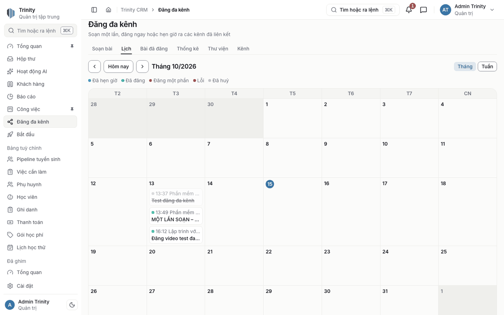

<div align="center">

# Trinity

**The open-source AI-native CRM.** Our vision: the AI operating system for business.
Run your whole company by chatting with the AI assistant you already love: ChatGPT, Claude, Gemini, and more.

Created by **Thanh Tran** · [X @trntnthnh](https://x.com/trntnthnh) · [YouTube](https://www.youtube.com/@ltvaicom) · [TikTok](https://www.tiktok.com/@laptrinhvoiai)

[Tiếng Việt](README.vi.md) · [Website](https://phanmemtrinity.com) · [Deploy](#deploy) · [Roadmap](ROADMAP.md) · [Contributing](CONTRIBUTING.md)

[](https://github.com/tanthanhkid/trinity/actions/workflows/ci.yml)
[](https://github.com/tanthanhkid/trinity/security/code-scanning)
[](https://scorecard.dev/viewer/?uri=github.com/tanthanhkid/trinity)
[](LICENSE)


</div>

---

<p align="center"></p>

<p align="center"><sub>Real recording: ChatGPT with the Trinity plugin, on a fresh install. The AI acts with your permissions, so the changes appear right away.</sub></p>

## Why Trinity

Most business software makes you learn its menus. Trinity flips that around: **you tell your AI assistant what you need, and it runs the system for you.**

- **"Add Mr. Nam from Gò Vấp, interested in product A, call him back Friday."** Done: contact, deal and reminder are created.
- **"How did the Q3 campaign do compared to Q2?"** Your assistant reads the data and answers with a chart.
- **"Which customers haven't heard from us in two weeks? Make me a call list for tomorrow."** Your assistant reads the pipeline and creates the tasks.

**Start lean, grow with you.** The first sign-in opens a short wizard: pick your type of business (education center, retail and services, clinic or spa, real estate, or Other), tick the modules you want, press *Build my system*, and the lists, screens and menu are ready, no AI needed. A few clearly fake sample records show you around and delete themselves when you add your first real customer or record. A core set (overview, customers, tasks, reports) is always on; everything else is a switch in Settings › Features, and the menu only shows what is on. Your AI assistant can still build or reshape the workspace (the `setup_build` and `propose_workspace` tools).

**Built for Vietnamese businesses first.** Zalo, VietQR, Vietnamese UI and data formats work out of the box. Global CRMs don't cover these.

## How it works

Trinity ships a built-in **[Model Context Protocol (MCP)](https://modelcontextprotocol.io) server** with OAuth login. Connecting an assistant is optional: in the app, *Bắt đầu* ("Get started") asks which assistant you use (ChatGPT, Claude, Claude Code, Antigravity, Gemini CLI, Cursor, Codex CLI, VS Code Copilot…) and copies one prompt: paste it and the assistant adds the server and signs you in. Any MCP-capable assistant connects to it and gets tools for records, pipelines and reports, scoped by the connecting user's role. The server itself never calls an AI model and holds no AI API keys: the intelligence comes from the assistant you bring.

```
Your AI assistant (ChatGPT · Claude · Gemini · Cursor · OpenClaw …)
        │  MCP + OAuth
        ▼
Trinity  ──  CRM · Sales · Zalo · HR · Reports
```

## Features

| Area | What you get |
|---|---|
| **AI control (MCP)** | Built-in MCP server: connect ChatGPT, Claude, Gemini, Cursor, OpenClaw or any MCP client. Read and write data directly within the connected user's permissions (writes need the `crm.write` scope; every action is listed under AI activity). Optional setting *Require approval for AI changes* turns on a draft-then-approve flow |
| **AI-native overview** | The home page shows which AI assistants are connected and active, what they did today, and every connected channel (Fanpage, Zalo OA, payments, online store) with its status and today's counts. With no assistant yet, it walks you through connecting one |
| **Connections** | One menu for every channel, payment, sales and data connector, grouped, each with its status and setup steps. Connecting a Facebook Page once covers both incoming messages and comments and posting |
| **Feature switches** | Settings › Features: grouped cards (core, channels & inbox, sales, people, advanced), one switch each. Turning a feature off hides it for everyone and keeps the data. Your AI can list and switch features too (switching off needs your OK) |
| **Interactions** | Fanpage comments, Messenger and Zalo OA conversations in one timeline: today's counts, what each rule did, filters (channel, Page, unanswered, date) and a reply box in place. New comments and messages ring the bell for the customer's owner and the channel's assignee. Your AI assistant can read the timeline and draft replies you approve |
| **Shared inbox** | Messenger and Zalo OA conversations in one place, with search and an "awaiting reply" filter; replies respect each platform's messaging window (Messenger: 24 hours; up to 7 days for a reply typed by your staff once Meta grants your app the Human Agent permission). Opening a conversation also fetches messages straight from Facebook, so none are lost if a notification never arrived |
| **Facebook Page automation** | Comment rules per Page or per post (including the cover photo): auto-replies, hiding phone numbers, private replies, each commenter linked to a customer; chat links and QR codes that open a conversation; Messenger flows; broadcasts within the 24-hour window. Rules, flows and broadcasts can also be created and edited from your AI assistant |
| **Multi-channel posting** | Write once, publish or schedule to Facebook Pages (Fanpage), with a content calendar, a media library and post stats. Drafts, a weekly posting queue (time slots), reusable hashtag sets and signatures, UTM tagging of links, a per-channel preview of exactly what each network will show, bulk import from CSV, and recurring posts (daily, weekly or monthly). Large videos upload in parts, and posts deleted directly on the network show as deleted. All of it can also be driven from your AI assistant |
| **Online store** | A storefront at `/s/<name>` (or a subdomain) with three themes, a cart, cash on delivery or bank-transfer QR; orders and buyers land in the CRM. Off by default |
| **CRM** | Contacts with your own sources, stages and statuses, Kanban pipelines, shared record codes and `@` linking across screens, newsfeed |
| **Sales** | Products, POS |
| **People** | HR, attendance, payroll |
| **Insights** | Dashboards and reports |
| **Access control** | Roles and data scopes |

### How far it is tested

- **Tested end to end on a fresh deploy** (a new Postgres database; done on the former Vercel path, not yet repeated with Docker Compose): first sign-in, connecting an AI assistant, building tables by chat, importing records, the AI tools.
- **Tested with real accounts**: publishing and scheduling posts to Facebook Pages, Messenger messages, Facebook comment rules (auto-replies, hiding phone numbers), the Interactions timeline, incoming Zalo OA messages.
- **Tested with sample data only**: the posting queue, recurring posts and CSV import, dashboards and reports, the AI-native overview, feature switches, POS, HR, attendance and payroll, the online store (sample shop).
- These areas have automated tests; connectors are listed below.

### Connectors and how far each is tested

| Connector | Tested |
|---|---|
| Facebook Page | With real accounts |
| Zalo OA | Incoming messages tried with a real account; replies and sender profile need a paid Zalo OA (Tier) plan, not yet tried |
| n8n | Sample workflows run against a test server |
| Zapier, Make | Ready — not yet tried with a real account |
| iPOS | Not built yet — waiting for iPOS's partner API |

Details per connector: [docs/integrations/status.md](docs/integrations/status.md). What comes next: [ROADMAP.md](ROADMAP.md).

## See it

<table>
<tr>
<td width="50%"><br><sub>Every channel and connector on one screen</sub></td>
<td width="50%"><br><sub>Shared inbox for Messenger and Zalo OA</sub></td>
</tr>
<tr>
<td><br><sub>Content calendar for multi-channel posting</sub></td>
<td></td>
</tr>
</table>

<p align="center"></p>
<p align="center"><sub>Online store with a sample shop (test products, CC0 photos).</sub></p>

## Tech stack

Next.js 16 · React 19 · Tailwind 4 · NestJS 10 · Express · Prisma 6 · PostgreSQL 16 · pnpm monorepo.

## Deploy

Trinity runs on your own server (or a laptop) with Docker Compose. A 2 GB machine is the supported minimum.

You need Docker with Compose. On a laptop the first build takes about 5 minutes.

```bash
git clone https://github.com/tanthanhkid/trinity.git
cd trinity
./install.sh --up
```

`install.sh` creates `.env` from `.env.example` with freshly generated random secrets and admin password (it never overwrites an existing `.env`, so it is safe to re-run), prints the admin credentials once, and starts the stack with `docker compose up --build -d`. Open http://localhost:3000 and sign in with the printed admin account. No demo data is seeded by default; if you want demo data, set `SEED_DEMO_DATA=true` in `.env` (or run `SEED_DEMO_DATA=true ./install.sh`) before the first start.

Manual alternative: `cp .env.example .env`, replace every `change-me-*` value (`openssl rand -hex 32`), then `docker compose up --build -d`. If `SEED_ADMIN_PASSWORD` is empty, the generated password is printed by `docker compose logs migrate`.

Notes:

- The first admin is only created when it does not exist yet; restarting or upgrading never overwrites a password.
- A new workspace starts empty on purpose: the first sign-in goes through the start wizard (type of business, modules, *Build my system*, first customer) before the app opens. Anyone whose account is created after the workspace was built goes straight into the app. After the build the core set is on and everything else is a switch in Settings → *Tính năng* ("Features"); Zalo OA, for example, answers 403 until its switch is on. Settings is grouped in the Vietnamese UI as *Tính năng & Kết nối* (features & connections), *Khách hàng* (customer lists), *Công ty & Nhân sự* (users, roles, teams) and *Cá nhân* (profile, notifications); a section only shows when its feature is on.
- The interface is currently **Vietnamese only**. Your data and the AI tools work in any language.

Tagged releases publish ready-made images to GitHub Container Registry (`ghcr.io/tanthanhkid/trinity-api`, `ghcr.io/tanthanhkid/trinity-web`). More in [docs/deployment.md](docs/deployment.md).

To let your AI assistant drive Trinity, set `INTEGRATIONS_MCP_ENABLED=true`, a public `INTEGRATIONS_PUBLIC_BASE_URL` and an `INTEGRATIONS_SECRET_KEY` in `.env`, then follow [docs/integrations](docs/integrations/).

For development without Docker: `pnpm install && pnpm dev` (needs Node 22 and Postgres running locally).

### Monitoring (optional)

Error reporting (Sentry) and anonymous product metrics (PostHog) are **off by default**: no network call is made and
no SDK is loaded until you set the variables. Variables: `SENTRY_DSN` (API), `SENTRY_DSN_WEB` (browser),
`SENTRY_ENVIRONMENT`, `SENTRY_TRACES_SAMPLE_RATE`, `TRINITY_RELEASE`, `POSTHOG_KEY`, `POSTHOG_HOST`, `POSTHOG_REPLAY`,
`MONITORING_HASH_SECRET`. User ids are hashed (HMAC) before they leave your server; request bodies, cookies, headers,
query strings, emails and phone numbers are stripped; session replay (if enabled) masks all text and inputs. Server
events: `onboarding_step`, `feature_toggled`, `plan_changed`, `table_created`, `table_updated`, `post_published`,
`comment_rule_saved`, with keys, counts and booleans only. Details in [docs/deployment.md](docs/deployment.md#monitoring-optional).

## Why I built this

> *I'm Thanh. I build software with AI every day, and I kept seeing small businesses drown in menus and spreadsheets. So I built the system I wanted: one where you just tell your AI what to do. I'm giving it away so everyone can run their business this way.* — Thanh Tran

## Community

- 📺 YouTube: [Lập trình với AI](https://www.youtube.com/@ltvaicom) (Vietnamese tutorials, building with AI)
- 🎵 TikTok: [@laptrinhvoiai](https://www.tiktok.com/@laptrinhvoiai)
- 𝕏 X: [@trntnthnh](https://x.com/trntnthnh) (release news)
- 💬 Questions, ideas and show-and-tell: [GitHub Discussions](../../discussions)
- 🐛 Bugs: [GitHub Issues](../../issues)
- 🔒 Security issues: please follow [SECURITY.md](SECURITY.md), not public issues

## License

Trinity is licensed under **[AGPL-3.0](LICENSE)**. You can use, modify and self-host it for free. If you offer a modified version to others over a network, you must publish your changes under the same license.

Need to embed Trinity in a closed-source product or avoid AGPL obligations? A **commercial license** is available: see [COMMERCIAL.md](COMMERCIAL.md).

"Trinity" and the Trinity logo are trademarks. See [TRADEMARK.md](TRADEMARK.md).
