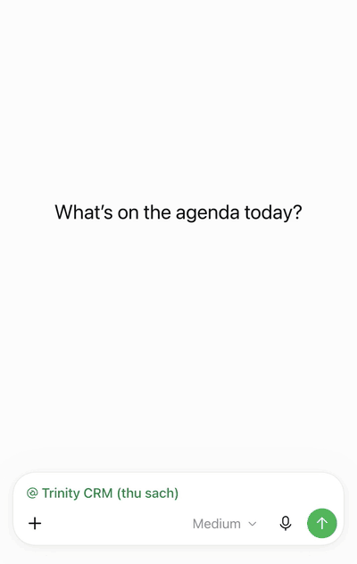
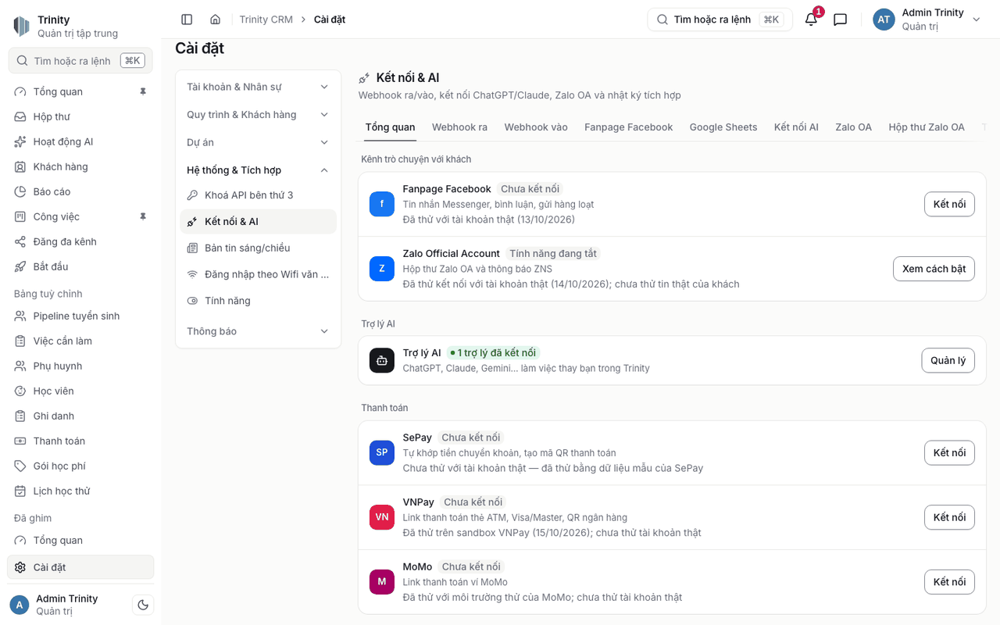
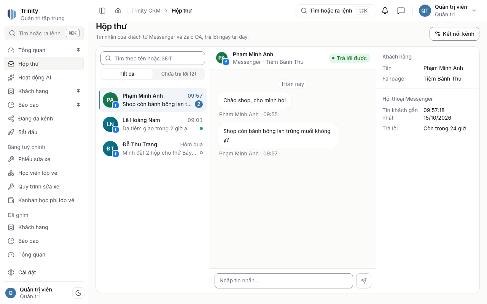
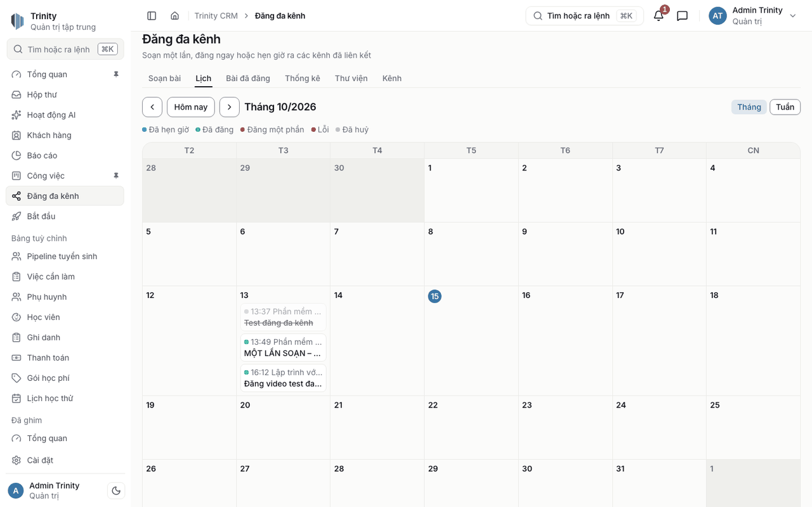
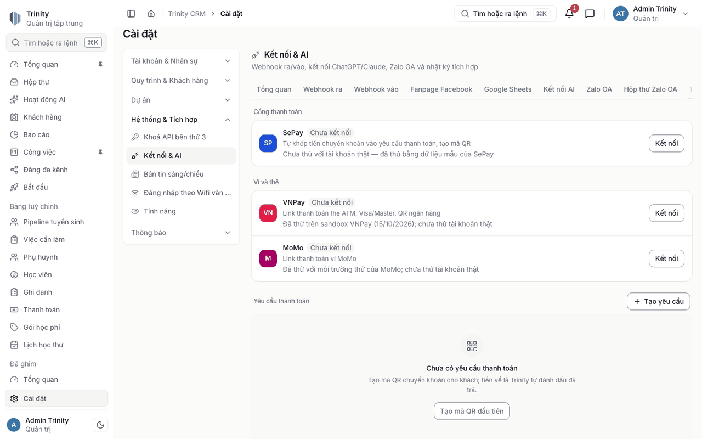

<div align="center">

# Trinity

**CRM mã nguồn mở vận hành bằng AI.** Tầm nhìn: hệ điều hành AI cho doanh nghiệp.
Điều hành cả công ty chỉ bằng cách trò chuyện với trợ lý AI bạn yêu thích: ChatGPT, Claude, Gemini và nhiều hơn nữa.

Tác giả: **Trần Tấn Thành** · [X @trntnthnh](https://x.com/trntnthnh) · [YouTube](https://www.youtube.com/@ltvaicom) · [TikTok](https://www.tiktok.com/@laptrinhvoiai)

[English](README.md) · [Website](https://phanmemtrinity.com) · [Triển khai](#triển-khai) · [Lộ trình](ROADMAP.md) · [Đóng góp](CONTRIBUTING.md)

[](https://github.com/tanthanhkid/trinity/actions/workflows/ci.yml)
[](https://github.com/tanthanhkid/trinity/security/code-scanning)
[](https://scorecard.dev/viewer/?uri=github.com/tanthanhkid/trinity)
[](LICENSE)

</div>

---

<p align="center"></p>

<p align="center"><sub>Quay thật: ChatGPT có plugin Trinity, chạy trên một bản mới cài. AI làm việc bằng quyền của bạn nên các thay đổi hiện ra ngay.</sub></p>

## Vì sao là Trinity

Phần mềm quản lý nào cũng bắt bạn học menu. Trinity làm ngược lại: **bạn nói với trợ lý AI việc cần làm, AI điều khiển hệ thống thay bạn.**

- **"Thêm anh Nam ở Gò Vấp, quan tâm sản phẩm A, thứ Sáu gọi lại."** Xong: có khách, có cơ hội, có lịch nhắc.
- **"Chiến dịch quý 3 so với quý 2 thế nào?"** Trợ lý đọc dữ liệu, trả lời kèm biểu đồ.
- **"Khách nào hai tuần nay chưa ai liên hệ? Lập danh sách gọi cho ngày mai."** Trợ lý đọc quy trình bán hàng và tạo sẵn các việc.

**Mở ra gọn, lớn lên cùng doanh nghiệp.** Lần đăng nhập đầu tiên mở một wizard ngắn: chọn loại doanh nghiệp (trung tâm giáo dục, bán lẻ và dịch vụ, phòng khám/spa/thú y, bất động sản, hoặc Khác), tick các phân hệ muốn dùng, bấm *Dựng hệ thống* là có sẵn danh sách, màn hình và menu, không cần AI. Vài bản ghi mẫu (dữ liệu giả, ghi rõ là mẫu) giúp bạn xem thử và tự xoá khi bạn thêm khách hoặc bản ghi thật đầu tiên. Bộ cơ bản (Tổng quan, Khách hàng, Công việc, Báo cáo) luôn bật; phần còn lại là công tắc ở Cài đặt › Tính năng, menu chỉ hiện thứ đang bật. Trợ lý AI vẫn dựng hoặc chỉnh hệ thống được (tool `setup_build`, `propose_workspace`).

**Làm cho doanh nghiệp Việt trước tiên.** Zalo, VietQR, giao diện và định dạng dữ liệu tiếng Việt có sẵn. Đây là những thứ CRM nước ngoài không có.

## Cách hoạt động

Trinity có sẵn **MCP server** ([Model Context Protocol](https://modelcontextprotocol.io)) đăng nhập bằng OAuth. Nối trợ lý AI là tuỳ chọn: trong app, màn *Bắt đầu* hỏi bạn dùng trợ lý AI nào (ChatGPT, Claude, Claude Code, Antigravity, Gemini CLI, Cursor, Codex CLI, VS Code Copilot…) rồi chép sẵn một prompt: dán vào là trợ lý tự gắn máy chủ và mở trang đăng nhập. Trợ lý AI nào hỗ trợ MCP cũng kết nối được và nhận bộ công cụ thao tác bản ghi, quy trình, báo cáo, theo đúng quyền của người kết nối. Máy chủ Trinity không tự gọi AI và không giữ khoá AI nào: trí tuệ đến từ trợ lý của chính bạn.

## Tính năng

| Mảng | Có gì |
|---|---|
| **Điều khiển bằng AI (MCP)** | MCP server có sẵn: kết nối ChatGPT, Claude, Gemini, Cursor, OpenClaw hay bất kỳ trợ lý nào hỗ trợ MCP; đọc và ghi dữ liệu trực tiếp trong phạm vi quyền của người đã kết nối (ghi cần scope `crm.write`; mọi thao tác hiện ở mục Hoạt động AI). Có tuỳ chọn *Yêu cầu duyệt thay đổi do AI*: bật lên thì AI chỉ soạn nháp, người duyệt |
| **Tổng quan kiểu AI** | Trang đầu cho thấy trợ lý AI nào đang kết nối và đang làm việc, hôm nay AI đã làm gì, và mọi kênh đã nối (Fanpage, Zalo OA, thanh toán, trang bán hàng) kèm trạng thái và số liệu hôm nay. Chưa nối AI thì hướng dẫn nối từng bước |
| **Bật/tắt tính năng** | Cài đặt › Tính năng: thẻ chia nhóm (cơ bản, kênh & hộp thư, bán hàng, nhân sự, nâng cao), mỗi tính năng một công tắc. Tắt thì ẩn với mọi người, dữ liệu vẫn giữ. AI cũng xem và bật/tắt được (tắt cần bạn đồng ý) |
| **Kết nối** | Một menu cho mọi kênh, cổng thanh toán, phần mềm bán hàng và nguồn dữ liệu, chia nhóm, mỗi mục có trạng thái và các bước nối. Nối Fanpage Facebook một lần là có cả nhận tin, bình luận lẫn đăng bài |
| **Tương tác** | Bình luận Fanpage, tin Messenger và Zalo OA trên một dòng thời gian: số liệu hôm nay, luật nào đã xử lý gì, bộ lọc (kênh, Page, chưa trả lời, ngày) và ô trả lời ngay tại chỗ. Bình luận, tin mới rung chuông báo người phụ trách khách và người phụ trách kênh. Trợ lý AI đọc được dòng thời gian và soạn câu trả lời để bạn duyệt |
| **Hộp thư chung** | Tin Messenger và Zalo OA ở một chỗ, có ô tìm và bộ lọc "Chưa trả lời"; trả lời đúng khung thời gian mỗi nền tảng cho phép (Messenger: 24 giờ; nhân viên tự gõ thì tới 7 ngày, khi app của bạn đã được Meta cấp quyền Human Agent). Mở hội thoại là đọc thêm tin thẳng từ Facebook, không sót tin khi thông báo không về |
| **Tự động hoá Fanpage** | Luật bình luận theo Page hoặc từng bài (kể cả ảnh bìa): tự trả lời, ẩn bình luận có số điện thoại, nhắn riêng, người bình luận tự gắn với khách hàng; link và mã QR mở thẳng cuộc chat; kịch bản Messenger; gửi tin hàng loạt trong cửa sổ 24 giờ. Luật, kịch bản, gửi hàng loạt cũng tạo và sửa được từ trợ lý AI |
| **Đăng đa kênh** | Soạn một lần, đăng ngay hoặc hẹn giờ lên Fanpage Facebook; có lịch nội dung, thư viện ảnh/video, số liệu bài. Lưu nháp, hàng đợi theo khung giờ cố định mỗi tuần, bộ hashtag và chữ ký dùng lại, tự gắn UTM vào liên kết, xem trước bài trên từng kênh, nhập nhiều bài từ CSV, bài lặp lại (ngày, tuần, tháng). Video lớn tải lên từng phần; bài bị xoá thẳng trên mạng tự hiện là đã xoá. Mọi việc cũng làm được qua trợ lý AI |
| **Thanh toán** | Đối soát yêu cầu thanh toán cũ: tiền về qua SePay, VNPay, MoMo tự khớp vào yêu cầu (không tạo yêu cầu mới) |
| **Trang bán hàng** | Trang bán online `/s/<tên>` (hoặc tên miền phụ), 3 giao diện, giỏ hàng, COD hoặc chuyển khoản QR; đơn và người mua vào thẳng CRM. Mặc định tắt |
| **CRM** | Danh bạ với nguồn, giai đoạn, trạng thái do bạn tự đặt, Kanban, mã bản ghi chung và gắn thẻ `@` giữa các màn, bảng tin |
| **Bán hàng** | Sản phẩm, POS |
| **Nhân sự** | Hồ sơ, chấm công, lương |
| **Báo cáo** | Dashboard, báo cáo |
| **Phân quyền** | Vai trò và phạm vi dữ liệu |

### Đã thử tới đâu

- **Thử trọn vòng trên bản cài mới** (cơ sở dữ liệu Postgres mới; thử trên đường Vercel cũ, chưa thử lại với Docker Compose): đăng nhập lần đầu, nối trợ lý AI, dựng bảng bằng chat, nhập dữ liệu, các tool AI.
- **Thử với tài khoản thật**: đăng ngay và hẹn giờ lên Fanpage, tin nhắn Messenger, luật bình luận Fanpage (tự trả lời, ẩn số điện thoại), dòng thời gian Tương tác, tin Zalo OA gửi đến.
- **Mới thử với dữ liệu mẫu**: hàng đợi đăng bài, bài lặp lại, nhập CSV, dashboard và báo cáo, Tổng quan kiểu AI, bật/tắt tính năng, POS, nhân sự, chấm công, lương, trang bán hàng (cửa hàng mẫu).
- Các mảng này có test tự động; connector ở bảng dưới.

### Connector và mức đã thử

| Connector | Đã thử |
|---|---|
| Fanpage Facebook | Với tài khoản thật |
| Zalo OA | Nhận tin đã thử thật; trả lời + đọc hồ sơ cần OA gói Tier (chưa thử) |
| VNPay | Trọn vòng trên sandbox VNPay |
| MoMo | Môi trường test của MoMo |
| n8n | Workflow mẫu chạy thật với máy chủ thử |
| SePay, Zapier, Make | Connector có sẵn, chưa thử với tài khoản thật |
| iPOS | Chưa làm — chờ iPOS cấp API đối tác |

Chi tiết từng connector: [docs/integrations/status.md](docs/integrations/status.md). Việc sắp làm: [ROADMAP.md](ROADMAP.md).

## Xem nhanh

<table>
<tr>
<td width="50%"><br><sub>Mọi kênh và connector trên một màn</sub></td>
<td width="50%"><br><sub>Hộp thư chung Messenger + Zalo OA</sub></td>
</tr>
<tr>
<td><br><sub>Lịch nội dung đăng đa kênh</sub></td>
<td><br><sub>Thanh toán: đối soát yêu cầu cũ</sub></td>
</tr>
</table>

<p align="center"></p>
<p align="center"><sub>Trang bán hàng với cửa hàng mẫu (sản phẩm thử, ảnh CC0).</sub></p>

## Triển khai

Trinity chạy trên máy chủ của bạn (hoặc laptop) bằng Docker Compose. Cấu hình tối thiểu được hỗ trợ là máy 2 GB RAM.

Cần Docker có Compose. Lần build đầu trên laptop mất khoảng 5 phút.

```bash
git clone https://github.com/tanthanhkid/trinity.git
cd trinity
./install.sh --up
```

`install.sh` tạo `.env` từ `.env.example` với các secret và mật khẩu admin ngẫu nhiên (không bao giờ ghi đè `.env` có sẵn nên chạy lại an toàn), in thông tin admin một lần, rồi chạy `docker compose up --build -d`. Mở http://localhost:3000 và đăng nhập bằng tài khoản admin vừa in. Mặc định không nạp dữ liệu demo; muốn dữ liệu demo thì đặt `SEED_DEMO_DATA=true` trong `.env` (hoặc chạy `SEED_DEMO_DATA=true ./install.sh`) trước lần khởi động đầu.

Cách thủ công: `cp .env.example .env`, thay mọi giá trị `change-me-*` (`openssl rand -hex 32`), rồi `docker compose up --build -d`. Nếu `SEED_ADMIN_PASSWORD` để trống, mật khẩu sinh ra được in ở `docker compose logs migrate`.

Lưu ý:

- Admin đầu tiên chỉ được tạo khi chưa tồn tại; khởi động lại hay nâng cấp không bao giờ ghi đè mật khẩu.
- Workspace mới cố ý bắt đầu trống: lần đăng nhập đầu tiên đi qua wizard bắt đầu (loại doanh nghiệp, phân hệ, *Dựng hệ thống*, khách đầu tiên) rồi mới vào app; người có tài khoản tạo sau khi hệ thống đã dựng vào thẳng app. Sau khi dựng, bộ cơ bản bật sẵn, phần còn lại là công tắc ở Cài đặt → *Tính năng*; ví dụ Zalo OA chưa bật thì trả 403. Cài đặt chia nhóm *Tính năng & Kết nối*, *Khách hàng*, *Công ty & Nhân sự*, *Cá nhân*; mục nào thuộc tính năng đang tắt thì ẩn.

Mỗi bản phát hành gắn tag đẩy sẵn image lên GitHub Container Registry (`ghcr.io/tanthanhkid/trinity-api`, `ghcr.io/tanthanhkid/trinity-web`). Chi tiết ở [docs/deployment.md](docs/deployment.md).

Để trợ lý AI điều khiển Trinity, đặt `INTEGRATIONS_MCP_ENABLED=true`, một `INTEGRATIONS_PUBLIC_BASE_URL` công khai và `INTEGRATIONS_SECRET_KEY` trong `.env`, rồi làm theo [docs/integrations](docs/integrations/).

Phát triển không dùng Docker: `pnpm install && pnpm dev` (cần Node 22 và Postgres chạy cục bộ).

## Vì sao mình làm Trinity

> *Mình là Thành. Ngày nào mình cũng làm phần mềm cùng AI, và mình thấy các doanh nghiệp nhỏ ngập trong menu với bảng tính. Nên mình làm ra hệ thống mình muốn có: chỉ cần nói với AI việc cần làm. Mình mở miễn phí để ai cũng điều hành doanh nghiệp được theo cách này.* — Trần Tấn Thành

## Cộng đồng

- 📺 YouTube: [Lập trình với AI](https://www.youtube.com/@ltvaicom), hướng dẫn tiếng Việt, làm phần mềm cùng AI
- 🎵 TikTok: [@laptrinhvoiai](https://www.tiktok.com/@laptrinhvoiai)
- 𝕏 X: [@trntnthnh](https://x.com/trntnthnh), tin phát hành
- 💬 Hỏi đáp, ý tưởng, khoe cách dùng: [GitHub Discussions](../../discussions)
- 🐛 Báo lỗi: [GitHub Issues](../../issues)
- 🔒 Lỗ hổng bảo mật: báo riêng theo [SECURITY.md](SECURITY.md), đừng đăng issue công khai

## Giấy phép

Trinity dùng giấy phép **[AGPL-3.0](LICENSE)**: dùng, sửa, tự cài miễn phí. Nếu bạn cho người khác dùng bản đã sửa qua mạng, bạn phải công khai phần sửa theo cùng giấy phép.

Muốn nhúng Trinity vào sản phẩm đóng mã hoặc không muốn ràng buộc AGPL? Có **giấy phép thương mại**, xem [COMMERCIAL.md](COMMERCIAL.md).

"Trinity" và logo Trinity là nhãn hiệu, xem [TRADEMARK.md](TRADEMARK.md).
